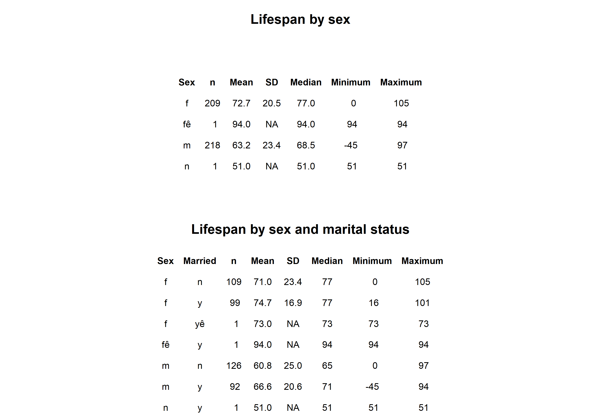
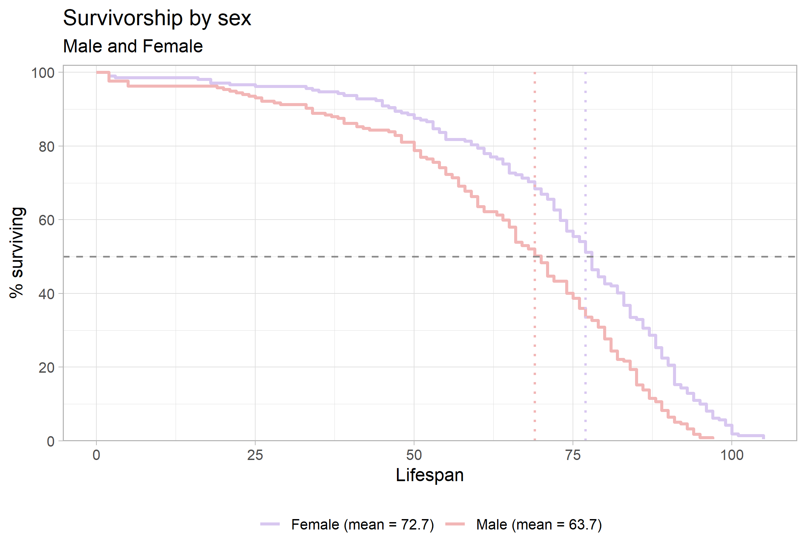
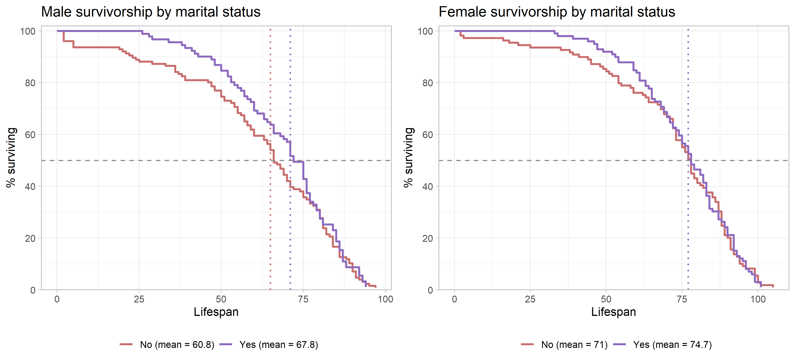

```{=latex}
\onecolumn
\begingroup
\thispagestyle{empty}
\sffamily

% Publication line and journal masthead
\noindent
\begin{minipage}[t]{0.66\linewidth}
  \scriptsize
  Hendrickson. \textit{Survivorship Curves of Sunset Hill Cemetery}
  \hfill (2026) 1:1\\
  Valdosta State University, Ecology and Evolution
\end{minipage}
\hfill
\begin{minipage}[t]{0.30\linewidth}
  \raggedleft
  \large Cemetery Demography\\[-2pt]
  \large BIOL 3250
\end{minipage}

\vspace{0.28in}

% Article-type band
\noindent
\colorbox{reportred}{%
  \parbox{\dimexpr\linewidth-2\fboxsep\relax}{%
    \color{white}
    \textbf{RESEARCH ARTICLE}\hfill
    \textbf{CLASS PROJECT}
  }%
}

\vspace{0.18in}

% Title and author line
\noindent
{\fontsize{23}{27}\selectfont
\textbf{Lifespan is Effected by Sex and Marital Status}\par}

\vspace{0.12in}

\noindent
{\small
Brandon Thomas Hendrickson\textsuperscript{1,*}
}

\vspace{0.08in}

% Structured abstract
\setlength{\fboxsep}{6pt}
\noindent
\fcolorbox{reportred}{white}{%
  \begin{minipage}{\dimexpr\linewidth-2\fboxsep-2\fboxrule\relax}
    \small

    \textbf{Abstract}

    \vspace{3pt}

    \textbf{Purpose:}
    This project describes lifespan patterns in cemetery records and examines
    variation by sex and marital status. [you can do military service of males or pre- and post- a particular year - default 1930]

    \vspace{3pt}

    \textbf{Methods:}
    Recorded available birth and death information from gravestones
    and classified selected characteristics using evidence visible on the
    stones and in burial arrangements. [Go into much greater detail in the methods section]

    \vspace{3pt}

    \textbf{Results:}
    [Summarize the principal patterns in the class data.]

    \vspace{3pt}

    \textbf{Conclusions:}
    [State what the observed patterns suggest and note limitations. Distinguish
    lifespan in this cemetery sample from population life expectancy.]

    \vspace{3pt}

    \textbf{Keywords:}
    cemetery records; lifespan; survivorship; marital status; historical demography
  \end{minipage}%
}

% Bottom-page author and institutional details
\vfill

\noindent\rule{0.56\linewidth}{0.4pt}

\vspace{3pt}

\noindent
{\scriptsize
\textsuperscript{*}Correspondence: bhendrickson@valdosta.edu\\
\textsuperscript{1}Department of Biology, Valdosta State University,
Valdosta, Georgia, USA\\
Ecology and Evolution, BIOL 3250, Section B
}

\vspace{0.10in}

\noindent
\begin{minipage}[c]{0.20\linewidth}
  \includegraphics[width=0.72in]{Valdosta_State_University_seal.png}
\end{minipage}
\endgroup
\twocolumn
```

# Background

Cemetery records provide individual birth and death dates that can be used to describe lifespan among people represented in a burial ground. These records are a non-random sample: cemetery access, preservation of markers, migration, family burial practices, and the choice of graves to record may all affect which people appear in the dataset. The analyses below therefore describe the collected sample and should not be treated as direct estimates of lifespan for an entire town or historical population.

# Hypotheses

Write each hypothesis before interpreting the figures. State the expected direction and identify the comparison.

1. **Sex and lifespan:** Females will have a longer lifespan than males collected in this sample. 
2. **Marriage and lifespan:** Married women will have a greater lifespan than married men.

# Methods

Complete the prompts below. Replace bracketed text with details from the field visit and the final class dataset.

## Field site and sampling

- **Where did you go?** Sunset hill Cemetery
- **What date and time of day did you collect records?** Sunny day on october 7th between 2pm-4pm
- **What part of the cemetery did you sample?** 1010 1/2 West St, Valdosta, GA 31601-4493, United States.30.841531, -83.290676
- **How did you choose graves?** Grave sampling was opportunistic and split between two group memebers. No more than 3 people from the same family were collected. Older graves and documented military service were slightly favored. 
- **How did you handle nearby graves and family plots?** When collecting data from a family plot we typically only collected up to three related members, beginning with the husband and wife, and possibly including one child. Graves nearby others but not in a marked plot were treated as separate unless the last name or epitaph marked them as related. 

## Recorded information and variable definitions

- **What information did you record from each marker?**  Name, birth year, death year, gender, and military service if applicable were recorded.
- **How was lifespan calculated?** Lifespan was calculated as death year minus the birth year. Graves missing a birth or death date were excluded from the sample data unless it was an infant with days of life marked within the same year and month. 
- **How did you determine marital status?** Shared tombstones, last name, and the epitaph were used to determine the marital status of the deceased.
- **How did you determine military service?** When recording military service, branch and year of service was taken from the epitaph.
- **How did you determine sex or gender?** Gender was determined by the epitaph as fact, while nebulous graves were inferred using typical naming trends or marriage status, but those are not confirmed.
- **How were missing, illegible, or ambiguous records handled?** Illegible graves or graves missing dates were excluded from this sample.

## Dataset and analysis

- **How many records were collected by you?** [n = 51 ]
- **How many records were included in the final analysis?** [n = ; 50.]
- **Were records aggregated with the class dataset?** yes
- **What summaries or plots were produced?** [Describe group summaries and empirical survivorship curves, including how categories were defined.] 
- **What are the limits of the sample?** The sample was limited by graves that were missing dates, missing complete names, graves that had been damaged or had significant overgrowth. Sample was also limited in size and location within the graveyard.

# Results

The summary table in @fig-summary shows substantial differences in recorded lifespan by sex in this sample. Males had a mean lifespan of 63.2 years (SD = 23.4; n = 218), compared with 72.7 years (SD = 20.5; n = 209) for females. The marital-status breakdown is more tentative because each subgroup contains only one or two records. Among males, married individuals had a mean lifespan of 66.6 years (SD = 20.6), while the unmarried  men had a mean lifespan of 60.8 years (SD = 25.0). Among females, the married individuals lived a mean life span of 74.7 year (SD = 16.9), compared with a mean of 71.0 years (SD = 23.4) for the unmarried female individuals. These small subgroup sizes make the values descriptive; they do not support broad conclusions about sex or marital status.

{#fig-summary width=90% fig-pos="t" fig-env="figure*"}

The sex-specific survivorship curves in @fig-sex show a different pattern: the plotted means are 63.2 years for males and 72.7 years for females. The male curve remains lower through much of the earlier and middle lifespan, while the female curve reaches the 50% survival point later. The curves are close and change relative position, so the figure suggests that the sex difference depends on which part of the lifespan distribution is considered. The median markers indicate where each group’s observed curve reaches 50% surviving; they are distinct from the mean values shown in the legend. From the table you can see how that marriedd women have a higher lifespan than those of men who are or are not married. 

{#fig-sex width=70% fig-pos="t" fig-env="figure*"}

The within-sex comparisons in @fig-married show higher plotted mean lifespans for married than unmarried individuals in both panels. For males, the plotted means are 66.6 years for married individuals and 60.8 years for unmarried individuals. For females, they are 74.7 and 71.1 years, respectively. The curves also place the 50% survival point later for the married groups. These are descriptive differences and should not be interpreted as evidence that marriage caused longer lifespan; other factors and the sizes and composition of the groups could contribute.

{#fig-married width=70% fig-pos="t" fig-env="figure*"}


# Discussion

**Sex and lifespan.** Research on sex differences in longevity points to a combination of biological, behavioral, and social influences rather than a single explanation. Austad and Fischer review evidence on sex differences in lifespan and aging across species, including humans [@austadSexDifferencesLifespan2016]. In this cemetery sample, the observed female and male curves show that women lived longer then men and supprts the prediction that women have a longer life span than that of men regardless of marital status. The result should be interpreted in the context of this cemetery’s birth cohorts and sampling process; it is not by itself an estimate of a general sex difference in lifespan.

```{=latex}
\newpage
```

### References

::: {#refs} 
::: 
